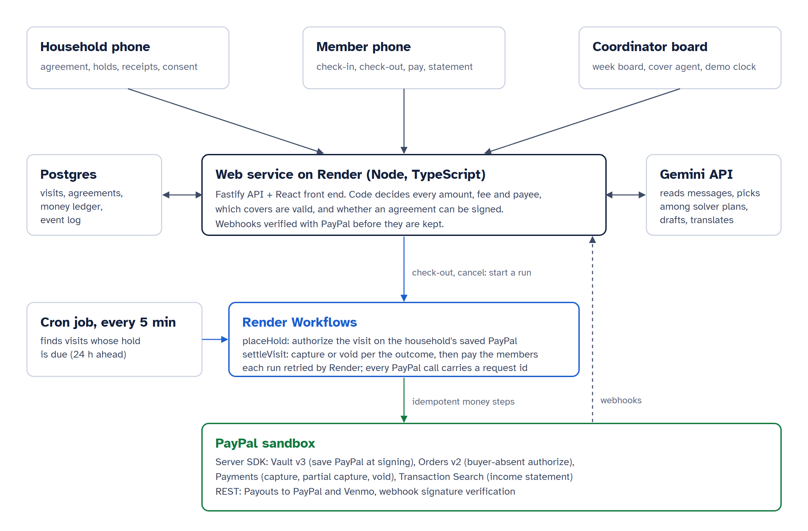

# Covered: cleaners' pay held before the work starts

    

**Covered runs a house-cleaning cooperative's week: each household's PayPal holds the visit's pay 24 hours ahead, and whoever does the visit is paid through PayPal Payouts when they check out.**

I audit payment systems for a living. In this trade, the cancellation fee and the week's pay are usually a promise; Covered makes both an authorization on PayPal before anyone travels.

| | |
|---|---|
| Built with | PayPal Server SDK (Vault v3, Orders v2, Payments, Transaction Search), PayPal Payouts, PayPal webhooks, Gemini API, Render Workflows, Render cron and Postgres, TypeScript, React, Fastify |
| Headline result | A full demo day on the PayPal sandbox: 30 holds, 3 captures including a late-cancel partial capture, 3 payouts final in about 25 s each; a crash between capture and payout ends in exactly 1 capture and 1 payout |

## For judges

| Criterion | Where it is answered |
|---|---|
| Technological implementation | [PayPal](#paypal) (six APIs, idempotent money steps), [Gemini, and where it stops](#gemini-and-where-it-stops), [docs/EVIDENCE.md](docs/EVIDENCE.md) sections 3 and 4 |
| Design | [The demo day](#the-demo-day): coordinator board, member and household phones in their own languages, sign-up by voice |
| Potential impact | [Who it is for](#who-it-is-for), [The rule](#the-rule) |
| Innovation | The hold belongs to the visit, so a cover keeps the money in place; the notice window and the hold are the same 24 hours |
| Presentation | [Measured](#measured), [Run it](#run-it) with no keys |

## Who it is for

Seattle passed Council Bill 121266 on 15 Sep 2026 (9-0). From 1 Jul 2027, domestic workers must get a written agreement that includes a cancellation policy, and records of hours and pay. A house cleaner who travels to a door that stays shut, or to a household that cancels at breakfast, loses the morning's pay unless the fee was collected in advance.

Covered is for a cleaning cooperative: a coordinator who plans the week, members who clean, and the households they clean for. It turns two lines of the ordinance into money that moves: the cancellation policy is a PayPal authorization, and the pay record is a PayPal transaction.

- **What goes in:** a household's job description, a member's terms in their own language (typed or spoken), and the members' messages on the day ("my son has a fever, I can't come in").
- **What comes out:**
  - a signed written agreement with the household's PayPal saved once;
  - a payment hold on every visit inside the notice window;
  - a capture and a payout at check-out, or the agreed fee on a late cancellation;
  - cover plans when someone is out;
  - a monthly income statement with a PayPal transaction id on every line.

## How it works



*The web service decides every amount. Render Workflows run the money steps against PayPal, retried on failure. Gemini reads and writes words, and code checks every number it writes.*

## The rule

The notice window and the payment hold are the same 24 hours.

| When the household cancels | What happens on PayPal |
|---|---|
| More than 24 hours ahead | Nothing was held, nothing is charged |
| Inside the 24 hours | The agreed fee (50% by default) is captured with `final_capture`, the rest of the authorization is released, and the fee is paid out to the member who kept the morning free |
| Nobody lets the cleaner in | The lock-out fee (100% by default) is captured and paid out |
| The visit happens | The booked time, plus any extra time the household approves at check-out, is captured; the member is paid within the minute |

The hold belongs to the **visit**, not to the member. When Sam calls in sick at 07:10 and Marek covers, the household's hold does not move; it pays whoever checks out. The cooperative keeps a share set in its terms (5% in the demo) and the member gets the rest.

## The demo day

Thursday 19 November 2026, Rainier Home Care Cooperative, Seattle. Every person is fictional, and every screen says so.

1. **07:10.** Sam messages the coordinator, Dana: his son has a fever. Gemini reads the message, and the solver lists every valid way to cover Sam's three homes. The agent picks one and explains why. The plan appears on the board as dashed bars.
2. Dana approves. Teresa takes the Santoses and the Murphys. Marek takes the Okafors, who asked for the same cleaner every time, so they are asked first on their phone. Each message goes out in the recipient's language: Portuguese for Teresa, Polish for Marek.
3. **09:00 to 13:05.** Marek checks in and out on his phone, in Polish. The $140.00 visit is captured from the $157.50 hold, $17.50 is released, and $133.00 reaches Marek through PayPal Payouts.
4. **13:30.** Mr. Lindqvist cancels his 14:00 visit. His phone shows the $35.00 fee before he confirms. $35.00 is captured, $52.50 is released, and Marek receives $33.25 for the afternoon he kept free.
5. Marek opens his income statement and makes a link for a landlord: months, hours and totals, each line tied to a PayPal transaction, with no household names or addresses.
6. A new household, the Parks, describes the job in English and reads the agreement in Korean. Teresa states her terms in a Portuguese voice note. The checklist decides when the agreement can be signed, and signing saves the Parks' PayPal.

A demo clock in the coordinator view moves the day forward, so the whole day fits in a few minutes. Every PayPal call is still a real sandbox call.

## PayPal

| PayPal API | What Covered uses it for | Code |
|---|---|---|
| Vault v3 (setup token, payment token) through the PayPal Server SDK | The household saves PayPal once, when it signs | `server/signup.ts`, `server/paypal/sandbox.ts` |
| Orders v2, `intent: AUTHORIZE`, vaulted PayPal with `stored_credential` (merchant-initiated, unscheduled) | The hold, placed with no buyer present 24 hours before each visit | `server/tasks.ts` `placeHold` |
| Payments: capture with `final_capture`, partial capture, void | Check-out, late-cancel fee with release of the remainder, no-cover release | `server/tasks.ts` `settleVisit` |
| Payouts (REST), to a PayPal email or a Venmo phone | The member's pay, polled until the batch is final | `server/tasks.ts` |
| Transaction Search | Reconciles the income statement line by line | `server/statements.ts` |
| Webhooks with `verify-webhook-signature` | Deliveries are kept only when PayPal confirms them, and are tied to the visit by invoice id | `server/api.ts` |

Every money call carries a `PayPal-Request-Id` and an invoice id built from the visit and the demo run. Payouts carry a `sender_batch_id` built the same way. A retried task can never charge or pay twice: on the sandbox, PayPal answers a repeated capture with `AUTHORIZATION_ALREADY_CAPTURED` and a repeated payout with "Batch with given sender_batch_id already exists".

Orders, Payments, Vault and Transaction Search go through `@paypal/paypal-server-sdk`, the PayPal Server SDK generated by APIMatic.

## Gemini, and where it stops

| Gemini does | Code does |
|---|---|
| Reads a member's message: out today, out from a time, or nothing to do | Finds the affected visits |
| Chooses among the solver's plans through function calling, and explains the choice | Lists only valid plans: availability, skills (pets, deep clean, fragrance-free), travel time between homes, weekly hours cap, same-cleaner consent |
| Writes each message in the recipient's language | Refuses any message with a number the tools did not give, and sends the template instead |
| Drafts the agreement from the household's words and the member's voice note | Decides whether it can be signed: the ordinance's fields and the Seattle minimum rate ($21.30/h) |
| Translates the agreement read-back | Refuses a translation that changes, drops or adds a number |
| Writes the cover letter on the income statement | Computes every figure in it |

The household's text and the member's note are passed as data. The rate, notice and fee come only from the member's own words, and code checks that each number the model extracted appears in what the member said.

The demo path's model answers are recorded in `data/ai-recordings/`, so the deployed demo answers instantly and the repository runs with no key. With a key, live calls go through a reply cache, a daily cap and a per-visitor cap. A busy model falls back to the next one, then to the code-built text.

## Measured

Full numbers and run details are in [docs/EVIDENCE.md](docs/EVIDENCE.md).

| What | Result |
|---|---|
| Pay-rule table: 40 cases worked out by hand before the engine was written | 40 / 40 |
| Property tests on the settlement engine | 9,000 random cases: money conserved, capture never above the hold, deterministic |
| Cover solver, development set (60 scenarios) | 55 of 55 placeable visits placed, 0 rules broken; "first free member" baseline: 68 of 86 placements break a rule |
| Cover solver, held-out set (20 scenarios, labelled before the solver ran) | 20 of 20 placed, 0 rules broken; baseline: 26 of 29 break a rule |
| Live PayPal sandbox day | 30 holds placed; three visits captured and paid out, including a partial capture with release; payouts final in 25 s |
| Crash between capture and payout, on the sandbox | Retried once: 1 capture, 1 payout; PayPal refused a second capture and a second payout batch |
| Self-attack: 13 hostile inputs (prompt injection, rate changes by message, forged webhook, dispute, crash) | 13 / 13 handled |
| Accessibility: axe-core (WCAG 2.1 AA) on every screen of the end-to-end story | 0 violations |
| Unit and integration tests | 76 passing; 4 browser tests drive the real UI in Chromium |

## Run it

Node 22 or later.

```
npm ci
npm run build
npm start
```

Open http://localhost:8787. With no keys, Covered runs the whole demo on a deterministic PayPal stand-in and the recorded model answers, with an embedded Postgres (PGlite) under `var/`.

To use the PayPal sandbox and Gemini, copy `.env.example` to `.env` and set:

| Variable | Purpose |
|---|---|
| `PAYPAL_CLIENT_ID`, `PAYPAL_CLIENT_SECRET` | Sandbox REST app with Vault and Payouts enabled |
| `COVERED_DEMO_VAULT_ID` | A sandbox payment token the demo households use for their holds |
| `COVERED_SANDBOX_PAYOUTS` | Routes the fictional members' payouts to sandbox receivers, e.g. `*=PAYPAL:receiver@personal.example.com` |
| `PAYPAL_WEBHOOK_ID` | The webhook id deliveries are verified against |
| `GEMINI_API_KEY` | Google AI Studio key |
| `DATABASE_URL` | Postgres in production |

Checks:

```
npm run typecheck
npm test                         # unit, property, rule table, lifecycle, webhooks
npm run eval                     # cover solver on the development set
npx tsx eval/run.ts --heldout    # held-out set
npm run e2e                      # the demo story in Chromium, with axe-core
npx tsx scripts/self-attack.ts   # hostile inputs, written to docs/self-attack.json
npx tsx scripts/durability.ts    # crash between capture and payout, on the PayPal sandbox
```

## Deploy on Render

`render.yaml` is a Blueprint for the web service, the Postgres database and the cron job. The Workflow service is created next to it from the same repository:

1. New Blueprint from this repository; fill the variables marked `sync: false`.
2. New Workflow service from this repository, start command `node --import tsx server/workflows.ts`, slug `covered-workflows`, with the same `DATABASE_URL`, PayPal variables and `COVERED_DEMO_VAULT_ID`.
3. Set `RENDER_API_KEY` on the web service and the cron job. The web service then starts `placeHold` and `settleVisit` as Workflow task runs, and the cron job starts `sweep` every 5 minutes.

Without `RENDER_API_KEY`, the same tasks run in-process with the same retry policy (3 retries, 1 s, backoff 1.5).

## Repository

| Path | Contents |
|---|---|
| `shared/rules/` | Pay-rule table (`cases.json`) and the settlement engine |
| `shared/agreement.ts` | The agreement and the ordinance checklist |
| `shared/seed.ts` | The fictional cooperative: 10 members, 36 households, one week of visits |
| `server/tasks.ts`, `server/workflows.ts`, `server/runner.ts` | Money tasks, the Render Workflows entry point, the local runner |
| `server/paypal/` | Sandbox client (Server SDK + REST) and the deterministic stand-in |
| `server/dispatch/` | Solver, cover agent, approval |
| `server/agreements.ts`, `server/signup.ts` | Agreement drafting, read-back, signing and vaulting |
| `server/statements.ts`, `server/evidence.ts` | Income statement, landlord link, dispute evidence |
| `server/crud.ts` | The week in scheduler CrudManager format: resources, availability calendars, events with travel buffers |
| `eval/` | Cover scenarios, labels from an exhaustive oracle, results |
| `web/` | React front end: board, member phone, household phone, sign-up, statement, evidence |
| `tests/` | Vitest suites and the Playwright story |

## Claims

| Claim | Code | Checked by |
|---|---|---|
| Holds are placed only for visits inside the notice window | `server/tasks.ts` `dueForHold`, `placeHold` | `tests/lifecycle.test.ts` "places holds only for visits inside the notice window" |
| A late cancellation captures the fee and releases the rest | `shared/rules/settle.ts`, `server/tasks.ts` `settleVisit` | `tests/lifecycle.test.ts`, `shared/rules/cases.json` (40 cases), `probe/RESULTS-EUR.md` |
| Money is conserved on every outcome | `shared/rules/settle.ts` | `tests/rules.test.ts` (9,000 random cases) |
| A retried task never captures or pays twice | `server/tasks.ts`, `server/paypal/types.ts` `requestId` | `tests/lifecycle.test.ts` "survives a crash", `scripts/durability.ts` on the sandbox |
| A demo reset moves real sandbox money again | `server/store.ts` `payRef` | `tests/lifecycle.test.ts` "moves real money again after a demo reset" |
| The agent can only choose a plan the solver returned | `server/dispatch/agent.ts` `submit_plan` | `tests/agent.test.ts`, `scripts/self-attack.ts` |
| The solver breaks no rule | `server/dispatch/solver.ts` | `eval/` (80 scenarios against an exhaustive oracle), CI |
| A message with a number the tools did not give is not sent | `server/ai/gemini.ts` `numbersOk` | `tests/agent.test.ts` "number check" |
| A translated read-back that changes a number is not shown | `server/agreements.ts` `keepsNumbers` | `tests/agent.test.ts` "read-back check" |
| An agreement below the Seattle minimum or missing an ordinance field cannot be signed | `shared/agreement.ts` `missing` | `scripts/self-attack.ts`, `tests/e2e/story.spec.ts` |
| A refused hold puts the visit at risk; the household saves PayPal again and the hold is placed | `server/tasks.ts`, `server/signup.ts` `startRepair`, `finishRepair` | `tests/lifecycle.test.ts` "holds again once the household saves PayPal again" |
| Unverified PayPal webhooks are refused | `server/api.ts`, `server/paypal/sandbox.ts` `verifyWebhook` | `tests/webhook.test.ts` |
| A dispute is answered from the ledger | `server/evidence.ts` | `tests/lifecycle.test.ts` "answers a dispute", `tests/e2e/story.spec.ts` |
| The landlord link is signed, expires, and hides households | `server/statements.ts` `share`, `openShare`, `landlordView` | `tests/share.test.ts`, `tests/e2e/story.spec.ts` |
| Every screen of the story passes axe-core | `web/` | `tests/e2e/story.spec.ts`, `docs/axe-report.json` |

## Scope

The cooperative, its members and households are fictional. Payments run on the PayPal sandbox. The agreement is a template built on the ordinance's list of fields, not legal advice. Demo data sent to the Gemini API free tier is fictional.

## Licence

Apache-2.0
