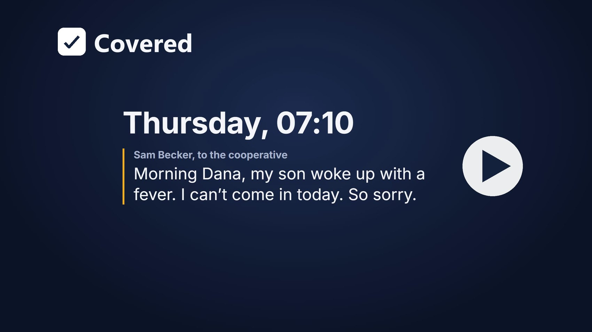
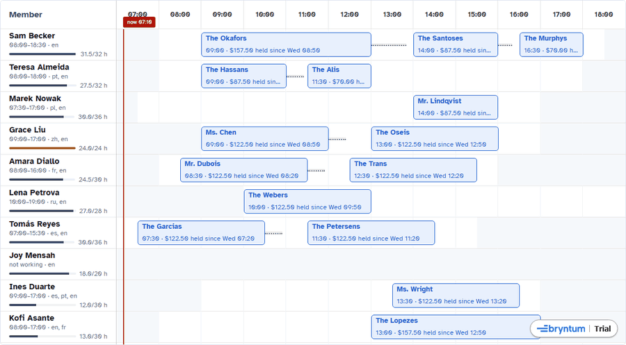
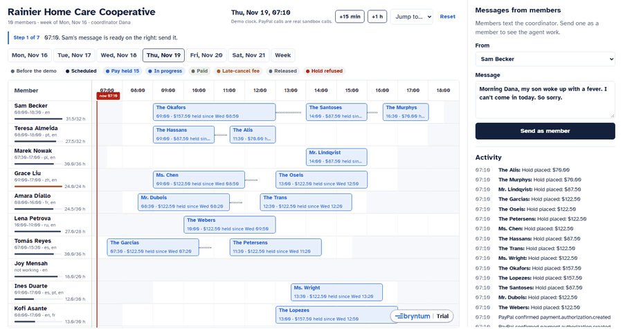
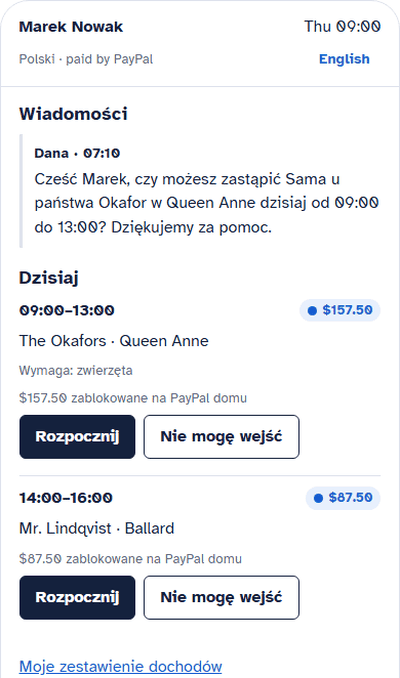
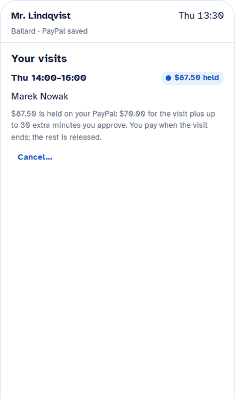
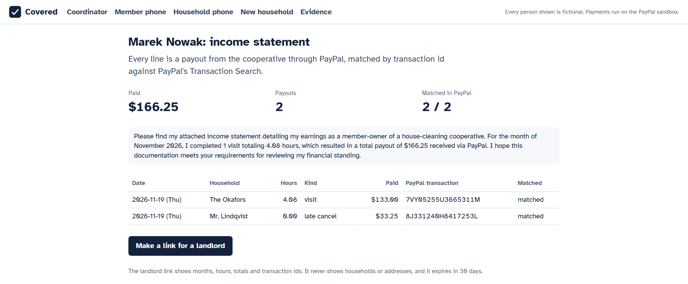

# Covered: cleaners' pay held before the work starts

[](https://github.com/Marc-Dvci/covered/actions/workflows/ci.yml) [](https://github.com/Marc-Dvci/covered/actions/workflows/codeql.yml) [](https://github.com/Marc-Dvci/covered/actions/workflows/live.yml)      

[](https://github.com/Marc-Dvci/covered#see-it-work)

**Covered runs a house-cleaning cooperative's week on one board: each household's PayPal holds the visit's pay 24 hours ahead, and whoever does the visit is paid through PayPal Payouts when they check out.**

I audit payment systems for a living. In this trade, the cancellation fee and the week's pay are usually a promise; Covered makes both of them a PayPal object before anyone travels.

[Try it](https://covered-coop.pages.dev/board) · [Film](https://github.com/Marc-Dvci/covered#see-it-work) · [For judges](#for-judges) · [See it work](#see-it-work) · [Run it](#run-it) · [Evidence](docs/EVIDENCE.md)

| | |
|---|---|
| Live demo, no login | **[covered-coop.pages.dev/board](https://covered-coop.pages.dev/board)**: Thursday, 07:10. A line above the board tells you each next step |
| Built with | PayPal Server SDK (Vault v3, Orders v2, Payments, Transaction Search), PayPal Payouts and Webhooks, Bryntum Scheduler Enterprise 8.0, Gemini API, Cloudflare Workers, Workflows, Durable Objects and Pages, TypeScript, React, Hono |
| Track | PayPal AI Hackathon, with the Bryntum and APIMatic sponsor prizes |
| Headline result | The whole day on the PayPal sandbox in US dollars: 15 holds placed in 10 s, a $140.00 capture and a $35.00 late-cancel fee with the rest released, payouts final in about 25 s, and each one matched in PayPal's Transaction Search. A crash between capture and payout ends in exactly 1 capture and 1 payout |

> [!TIP]
> Run it with no keys and no account: `npm ci && npm run build && npm start`, then http://localhost:8787. Or `docker compose up demo`. More in [Run it](#run-it).

## For judges

| Criterion | Where it is answered |
|---|---|
| Technological implementation | Hold: [placeHold](https://github.com/Marc-Dvci/covered/blob/v1.0.0/server/tasks.ts#L22-L53). Capture, release and payout: [settleMoney](https://github.com/Marc-Dvci/covered/blob/v1.0.0/server/tasks.ts#L61-L122). PayPal client: [sandbox.ts](https://github.com/Marc-Dvci/covered/blob/v1.0.0/server/paypal/sandbox.ts#L42-L81). Durable steps: [MoneyTask](https://github.com/Marc-Dvci/covered/blob/v1.0.0/worker/index.ts#L69-L98). The model's limits: [Gemini, and where it stops](#gemini-and-where-it-stops). All figures: [docs/EVIDENCE.md](docs/EVIDENCE.md) |
| APIMatic | [How the sponsors' products are used](#paypal): the Server SDK on every Orders, Payments, Vault and Transaction Search call, and the three changes its Context Plugin led to |
| Best use of Bryntum | [BoardScheduler.tsx](https://github.com/Marc-Dvci/covered/blob/v1.0.0/web/src/components/BoardScheduler.tsx#L135-L264): event buffers for travel, each member's own calendar, `calendarHighlight` driven by the solver, an asynchronous drop guard, and the week in CrudManager format from [crud.ts](https://github.com/Marc-Dvci/covered/blob/v1.0.0/server/crud.ts#L38-L127). See [The board](#the-board) |
| Design | [See it work](#see-it-work): coordinator board, member and household phones in their own languages, sign-up by voice, 0 axe-core violations |
| Potential impact | [Who it is for](#who-it-is-for), [The rule](#the-rule) |
| Innovation | The hold belongs to the visit, so a cover keeps the money in place, and the notice window and the hold are the same 24 hours: [the guard](https://github.com/Marc-Dvci/covered/blob/v1.0.0/server/actions.ts#L116-L139), [the move](https://github.com/Marc-Dvci/covered/blob/v1.0.0/server/actions.ts#L148-L162) |
| Presentation | [The film](https://github.com/Marc-Dvci/covered#see-it-work), [the live demo](https://covered-coop.pages.dev/board), [Run it](#run-it) with no keys |

## See it work



*The drag guard: only the members who can take the visit light up, and a refused row says why. The answers come from the same solver the agent uses, and the server checks again on the drop.*



*07:10: Sam is out. The agent's plan lands on the board as dashed bars, Dana approves, the bars move, and every hold stays where it was.*

<table>
<tr>
<td width="50%"></td>
<td width="50%"></td>
</tr>
<tr>
<td><em>Marek's phone, in Polish: check in, check out, and $133.00 paid. The wait on PayPal is cut.</em></td>
<td><em>Mr. Lindqvist sees the $35.00 fee before he confirms, and $52.50 of the $87.50 hold is released.</em></td>
</tr>
</table>



*Marek's statement on the live site: each payout matched by its transaction id in PayPal's Transaction Search, 2 of 2.*

## Who it is for

On 15 September 2026, Seattle's council passed Council Bill 121266, 9 to 0[^vote]. From 1 July 2027, a domestic worker's written agreement must state "the work cancellation policy, such as the acceptable notification period and any cancellation payment owed to the domestic worker", in English and in the worker's primary language, and the hiring entity must keep pay and hour records for three years[^ord]. A house cleaner who travels to a door that stays shut, or to a household that cancels at breakfast, loses the morning's pay unless the fee was collected in advance.

Covered is for a cleaning cooperative: a coordinator who plans the week, members who clean, and the households they clean for. It turns two lines of the ordinance into money that moves: the cancellation policy is a PayPal authorization, and the pay record is a PayPal transaction.

- **What goes in:** a household's job description, a member's terms in their own language (typed or spoken), and the members' messages on the day ("my son has a fever, I can't come in").
- **What comes out:**
  - a signed written agreement with the household's PayPal saved once;
  - a payment hold on every visit inside the notice window;
  - a capture and a payout at check-out, or the agreed fee on a late cancellation;
  - cover plans when someone is out;
  - a monthly income statement with a PayPal transaction id on every line.

[^vote]: [Council meeting minutes, 15 September 2026](https://seattle.legistar.com/View.ashx?M=M&ID=1443464&GUID=D9611EDE-3DA0-4F01-A044-46B87B387DE9): 9 in favor, none opposed.
[^ord]: [Ordinance 127508, adding section 14.23.025 to the Seattle Municipal Code](https://seattle.legistar.com/LegislationDetail.aspx?ID=8159864&GUID=032E91EF-CDF9-48EF-8FC7-26D89A4D4207); [the domestic workers page, with the $21.30 minimum for 2026](https://www.seattle.gov/laborstandards/ordinances/domestic-workers).

## How it works


*Code decides every amount. Workflows run the money steps against PayPal, each step retried on failure. Gemini reads and writes words, and code checks every number it writes.*

## The rule

The notice window and the payment hold are the same 24 hours.

| When the household cancels | What happens on PayPal |
|---|---|
| More than 24 hours ahead | Nothing was held, nothing is charged |
| Inside the 24 hours | The agreed fee (50% by default) is captured with `final_capture`, the rest of the authorization is released, and the fee is paid out to the member who kept the morning free |
| Nobody lets the cleaner in | The lock-out fee (100% by default) is captured and paid out |
| The visit happens | The booked time, plus any extra time the household approves at check-out, is captured, and the member is paid through Payouts |

The hold belongs to the **visit**, not to the member. When Sam calls in sick at 07:10 and Marek covers, the household's hold does not move; it pays whoever checks out. The cooperative keeps a share set in its terms (5% in the demo) and the member gets the rest.

## The demo day

Thursday 19 November 2026, Rainier Home Care Cooperative, Seattle. Every person is fictional, and every screen says so.

1. **07:10.** Sam messages the coordinator, Dana: his son has a fever. Gemini reads the message, and the solver lists every valid way to cover Sam's three homes. The agent picks one and explains why. The plan appears on the board as dashed bars.
2. Dana approves. Teresa takes the Santoses and the Murphys. Marek takes the Okafors, who asked for the same cleaner every time, so they are asked first on their phone. Each message goes out in the recipient's language: Portuguese for Teresa, Polish for Marek.
3. **09:00 to 13:05.** Marek checks in and out on his phone, in Polish. The $140.00 visit is captured from the $157.50 hold, $17.50 is released, and $133.00 reaches Marek through PayPal Payouts.
4. **13:30.** Mr. Lindqvist cancels his 14:00 visit. His phone shows the $35.00 fee before he confirms. $35.00 is captured, $52.50 is released, and Marek receives $33.25 for the afternoon he kept free.
5. Marek opens his income statement and makes a link for a landlord: months, hours and totals, each line tied to a PayPal transaction, with no household names or addresses.
6. A new household, the Parks, describes the job in English and reads the agreement in Korean. Teresa states her terms in a Portuguese voice note. The checklist decides when the agreement can be signed, and signing saves the Parks' PayPal.

A demo clock in the coordinator view moves the day forward, so the whole day fits in a few minutes. Every PayPal call on the live site is a real sandbox call. The week reloads by itself after 30 quiet minutes, so a visitor lands on 07:10.

## How the sponsors' products are used

### PayPal

| PayPal API | What Covered uses it for | Code |
|---|---|---|
| Vault v3 (setup token, payment token) through the PayPal Server SDK | The household saves PayPal once, when it signs, on PayPal's own approval page | `server/signup.ts`, `server/paypal/sandbox.ts` |
| Orders v2, `intent: AUTHORIZE`, vaulted PayPal with `stored_credential` (merchant-initiated, unscheduled) | The hold, placed with no buyer present 24 hours before each visit | `server/tasks.ts` `placeHold` |
| Payments: capture with `final_capture`, partial capture, void | Check-out, late-cancel fee with release of the remainder, no-cover release | `server/tasks.ts` `settleMoney` |
| Payouts (REST) | The member's pay, polled until the batch is final | `server/tasks.ts`, `worker/index.ts` |
| Transaction Search | Reconciles the income statement line by line, once PayPal has indexed the payout | `server/statements.ts` |
| Webhooks with `verify-webhook-signature` | Deliveries are kept only when PayPal confirms them, and are tied to the visit by invoice id or sender batch id | `server/api.ts` |

Every money call carries a `PayPal-Request-Id` and an invoice id built from the visit and the demo run. Payouts carry a `sender_batch_id` built the same way. A retried step can never charge or pay twice: on the sandbox, PayPal answers a repeated capture with `AUTHORIZATION_ALREADY_CAPTURED` and a repeated payout with "Batch with given sender_batch_id already exists".

Orders, Payments, Vault and Transaction Search go through `@paypal/paypal-server-sdk`, the PayPal Server SDK generated by APIMatic. I checked the client against APIMatic's [PayPal Server SDK Context Plugin](https://github.com/paypaldev/server-sdk-context-plugin-preview), and its TypeScript guides changed three things:

| The plugin's guide says | What Covered does |
|---|---|
| One rejected token request is cached and disables a long-lived client | The token is kept as a plain value, with a new SDK client per call ([`api()`](https://github.com/Marc-Dvci/covered/blob/v1.0.0/server/paypal/sandbox.ts#L60-L77)) |
| The generated `timeout` of `0` means no timeout at all | Every call sets 30 s, and SDK retries stay off under the Workflow's retry |
| A stub axios adapter through `unstable_httpClientOptions` is the seam for tests | [`tests/paypal-client.test.ts`](tests/paypal-client.test.ts) pins what each call sends over the wire, with no network |

### The board

The coordinator's week is a [Bryntum Scheduler](https://bryntum.com/products/scheduler/) at the Enterprise tier, version 8.0 (the former Scheduler Pro), from public npm with no Bryntum file in this repository. It runs as Bryntum's trial, whose 14 days count from the first run in each browser.

| Bryntum | What Covered uses it for |
|---|---|
| `resourceNonWorkingTime` with a calendar per member | Each row is shaded outside that member's own working hours |
| `eventBuffer` | Travel to the member's next home, computed from their real next visit |
| `calendarHighlight` with `collectAvailableResources` | While a bar is in the air, only the members the solver accepts light up |
| `eventDrag` `validatorFn`, and `beforeEventDropFinalize` with an asynchronous finalize | The solver's reason in the tooltip during the drag, and the server's final check on the drop |
| `resourceTimeRanges`, `timeRanges` | "Out today" across the absent member's row, and the demo clock's now line |
| Project in CrudManager format, stores with `syncDataOnLoad` | Each poll applies only what changed, so a moved bar animates and the view keeps its place |
| Non-continuous time axis | The week shows six working days from 07:00 to 19:00, with the nights removed |

### Cloudflare

| Cloudflare | What Covered uses it for |
|---|---|
| Workflows | One instance per money task. Each step is persisted and retried: place the hold; capture and pay; check the payout, with a durable sleep between checks; record the outcome |
| Durable Object with SQLite | The ledger: visits, money rows, events |
| Workers and a cron trigger | The API, and the sweep every 5 minutes |
| Pages | The public site, with `/api/*` forwarded to the Worker by a service binding |

All of it runs on the free plan.

## Gemini, and where it stops

| Gemini does | Code does |
|---|---|
| Reads a member's message: out today, out from a time, or nothing to do | Finds the affected visits |
| Chooses among the solver's plans through function calling, and explains the choice | Lists only valid plans: availability, skills (pets, deep clean, fragrance-free), travel time between homes, weekly hours cap, same-cleaner consent |
| Writes each message in the recipient's language | Refuses any message with a number the tools did not give, and sends the template instead |
| Drafts the agreement from the household's words and the member's voice note | Decides whether it can be signed: the terms the ordinance names and the Seattle minimum rate ($21.30/h) |
| Translates the agreement read-back | Refuses a translation that changes, drops or adds a number |
| Writes the cover letter on the income statement | Computes every figure in it |

The household's text and the member's note are passed as data. The rate, notice and fee come only from the member's own words, and code checks that each number the model extracted appears in what the member said. The agent has no tool that touches PayPal. [docs/SYSTEM_CARD.md](docs/SYSTEM_CARD.md) covers its uses, limits and human oversight.

The demo path's model answers are recorded in `data/ai-recordings.json`, so the live demo answers instantly and the repository runs with no key. With a key, live calls go through a reply cache, a daily cap and a per-visitor cap. A busy model falls back to the next one, then to the code-built text.

## What it will not do

- Move a visit that is under way, paid or released, or move one to a member who cannot take it. The drag guard and the server both refuse, with the reason.
- Release a checked-in visit: a member who started gets paid at check-out.
- Change a signed agreement, or a member's rate by message. A rate changes only through a new agreement.
- Keep a PayPal webhook whose signature PayPal does not confirm.

## Measured

Full numbers and run details are in [docs/EVIDENCE.md](docs/EVIDENCE.md).

| What | Result | Reproduce |
|---|---|---|
| Pay-rule table: 40 cases worked out by hand before the engine was written | 40 / 40 | `npm test` |
| Property tests on the settlement engine | 9,000 random cases: money conserved, capture never above the hold, deterministic | `npm test` |
| Mutation testing of the settlement engine | 143 of 154 mutants killed (92.86%) | Stryker, run once |
| Cover solver, development set (60 scenarios) | 55 of 55 placeable visits placed, 0 rules broken; "first free member" baseline: 68 of 86 placements break a rule | `npm run eval` |
| Cover solver, held-out set (20 scenarios, labelled before the solver ran) | 20 of 20 placed, 0 rules broken; baseline: 26 of 29 break a rule | `npx tsx eval/run.ts --heldout` |
| Live demo day on the PayPal sandbox, in USD | 15 holds in 10 s; 2 captures including a partial capture with release; payouts final in 23.7 s and 25.5 s; 18 verified webhooks, 0 refused | `npx tsx scripts/walk.ts`, [docs/live-run.json](docs/live-run.json) |
| Income statement against PayPal's Transaction Search, on the live site | 2 of 2 lines matched by transaction id, once PayPal had indexed the payouts | Play the story, wait 2 to 3 hours, then `scripts/examples.ts`; [the statement](examples/income-statement-marek.json) |
| Crash between capture and payout, on the live Cloudflare Workflows | Step retried: 1 capture, 1 payout; PayPal refused a second capture and a second payout batch | `npx tsx scripts/durability.ts`, [docs/durability-sandbox.json](docs/durability-sandbox.json) |
| Self-attack: 13 hostile inputs (prompt injection, rate changes by message, forged webhook, dispute, crash) | 13 / 13 handled | `npx tsx scripts/self-attack.ts`, [docs/self-attack.json](docs/self-attack.json) |
| Accessibility: axe-core (WCAG 2.1 AA) on every screen of the story, the board included | 0 violations | `npm run e2e`, [docs/axe-report.json](docs/axe-report.json) |
| Tests | 379 unit and integration, in random order, with no network and no keys; 17 browser tests | `npm test`, `npm run e2e` |
| Decision core coverage: pay rules, agreement checklist, solver, money tasks, visit actions, board data, runner | 97.7% of lines, 92% of branches | `npm run test:coverage` |

Open the outputs without running anything: [examples/](examples/README.md) holds an income statement, a landlord's view and the evidence for a dispute.

> [!IMPORTANT]
> The cooperative, its members and households are fictional. Payments are real calls to the PayPal sandbox, with no real money. The agreement is a template built on the ordinance's list of fields, not legal advice.

## Run it

Node 22.13 or later. No keys, no account:

```
npm ci
npm run build
npm start
```

Open http://localhost:8787. With no keys, Covered runs the whole demo on a deterministic PayPal stand-in and the recorded model answers, with a SQLite file under `var/`.

[](https://codespaces.new/Marc-Dvci/covered?quickstart=1)

Or with Docker: `docker compose up demo`, then http://127.0.0.1:8787.

To use the PayPal sandbox and Gemini, copy `.env.example` to `.env` and set:

| Variable | Purpose |
|---|---|
| `PAYPAL_CLIENT_ID`, `PAYPAL_CLIENT_SECRET` | Sandbox REST app with Vault, Payouts and Transaction Search enabled |
| `COVERED_DEMO_VAULT_ID` | A sandbox payment token the demo households use for their holds |
| `COVERED_SANDBOX_PAYOUTS` | Routes the fictional members' pay to a sandbox receiver, e.g. `*=PAYPAL:receiver@personal.example.com` |
| `PAYPAL_WEBHOOK_ID` | The webhook id deliveries are verified against |
| `GEMINI_API_KEY` | Google AI Studio key |

Checks:

```
npm run lint && npm run format:check && npm run typecheck
npm test                         # unit, property, rule table, API, lifecycle, webhooks
npm run test:coverage            # the same, with coverage of the decision core
npm run eval                     # cover solver on the development set
npx tsx eval/run.ts --heldout    # held-out set
npm run build && npm run e2e     # the story and the board in Chromium, with axe-core
npx tsx scripts/worker-smoke.ts  # the deployed shape in Cloudflare's own runtime, no account needed
```

Against a deployment (`LIVE_URL`, and PayPal keys for the durability check):

```
npx tsx probe/probe.ts           # every PayPal step, reads probe/.env
npx tsx scripts/walk.ts          # the story through the real UI
npx tsx scripts/durability.ts    # crash between capture and payout
npx tsx scripts/self-attack.ts   # hostile inputs
```

## Deploy on Cloudflare

Free plan, with no credit card:

```
npx wrangler login
npx wrangler secret bulk secrets.json      # the variables above
npm run deploy                             # the Worker, then the Pages site in deploy/pages
```

## Repository

| Path | Contents |
|---|---|
| `shared/rules/` | Pay-rule table (`cases.json`) and the settlement engine |
| `shared/agreement.ts` | The agreement and the ordinance checklist |
| `shared/seed.ts` | The fictional cooperative: 10 members, 36 households, one week of visits |
| `server/tasks.ts`, `server/runner.ts` | The money tasks and the in-process runner |
| `server/paypal/` | Sandbox client (Server SDK + REST) and the deterministic stand-in |
| `server/dispatch/` | Solver, cover agent, approval |
| `server/agreements.ts`, `server/signup.ts` | Agreement drafting, read-back, signing and vaulting |
| `server/statements.ts`, `server/evidence.ts` | Income statement, landlord link, dispute evidence |
| `server/crud.ts` | The week in scheduler CrudManager format, and the drag guard's verdicts |
| `worker/` | The deployed service: Workers entry, Workflows, the Durable Object ledger |
| `eval/` | Cover scenarios, labels from an exhaustive oracle, results |
| `web/` | React front end: board, member phone, household phone, sign-up, statement, evidence |
| `tests/` | Vitest suites and the Playwright story |
| `examples/` | Outputs of a run on the live site |

## Claims

| Claim | Code | Checked by |
|---|---|---|
| Holds are placed only for visits inside the notice window | `server/tasks.ts` `dueForHold`, `placeHold` | `tests/lifecycle.test.ts` "places holds only for visits inside the notice window" |
| A late cancellation captures the fee and releases the rest | `shared/rules/settle.ts`, `server/tasks.ts` `settleMoney` | `tests/lifecycle.test.ts` "charges the late-cancel fee inside the window and releases the rest", `shared/rules/cases.json` |
| Money is conserved on every outcome | `shared/rules/settle.ts` | `tests/rules.test.ts` (9,000 random cases) |
| A retried step never captures or pays twice | `server/tasks.ts`, `server/paypal/types.ts` `requestId` | `tests/lifecycle.test.ts` "survives a crash between capture and payout: one capture, one payout", `scripts/durability.ts` on the live site |
| A demo reset moves real sandbox money again | `server/store.ts` `payRef` | `tests/lifecycle.test.ts` "moves real money again after a demo reset: PayPal ids carry the reset's run tag" |
| The agent can only choose a plan the solver returned | `server/dispatch/agent.ts` `submit_plan` | `tests/agent.test.ts`, `scripts/self-attack.ts` |
| The solver breaks no rule | `server/dispatch/solver.ts` | `eval/` (80 scenarios against an exhaustive oracle), CI |
| The board refuses a member who cannot take the visit, and says why | `server/crud.ts` `guards`, `web/src/components/BoardScheduler.tsx` | `tests/e2e/board.spec.ts` "refuses a drag to a member who cannot take the visit, says why, and the bar stays", `tests/crud-extras.test.ts` |
| A valid drag moves the visit on the server and keeps its hold | `server/actions.ts` `move` | `tests/e2e/board.spec.ts` "a valid drag moves the visit on the server and keeps its hold" |
| A household's yes does not double-book a member | `server/actions.ts` `answerConsent` | `tests/regressions.test.ts` "a household's yes does not double-book a member who took another visit while it was asked" |
| A checked-in visit cannot be released | `server/actions.ts` `noCover` | `tests/regressions.test.ts` "a checked-in visit cannot be released, so the member still gets paid at check-out" |
| A signed agreement cannot be edited | `server/api.ts` | `tests/regressions.test.ts` "a signed agreement cannot be edited back to a draft" |
| A message with a number the tools did not give is not sent | `server/ai/gemini.ts` `numbersOk` | `tests/agent.test.ts` "accepts numbers the tools gave and rejects invented ones" |
| A translated read-back that changes a number is not shown | `server/agreements.ts` `keepsNumbers` | `tests/agent.test.ts` "rejects the live Portuguese answer that turned the $133.00 hold into $114.00" |
| An agreement below the Seattle minimum or missing a term the ordinance names cannot be signed | `shared/agreement.ts` `missing` | `tests/shared.test.ts`, `scripts/self-attack.ts` |
| A refused hold puts the visit at risk; the household saves PayPal again and the hold is placed | `server/tasks.ts`, `server/signup.ts` `startRepair`, `finishRepair` | `tests/lifecycle.test.ts` "holds again once the household saves PayPal again" |
| One failed token request does not break the PayPal client | `server/paypal/sandbox.ts` | `tests/paypal-client.test.ts` "one failed token request does not break the client for later calls" |
| The drag guard names the household, never an internal id | `server/dispatch/solver.ts` `readableReasons` | `tests/crud-extras.test.ts` "a member busy elsewhere is told apart by the household's name, never an internal visit id" |
| Unverified PayPal webhooks are refused | `server/api.ts`, `server/paypal/sandbox.ts` `verifyWebhook` | `tests/webhook.test.ts` "refuses a forged delivery and records the refusal" |
| A statement line reads as matched only once PayPal's Transaction Search lists its transaction id | `server/statements.ts` | `tests/api.test.ts` "a line stays pending until Transaction Search lists its transaction" |
| A dispute is answered from the ledger | `server/evidence.ts` | `tests/lifecycle.test.ts` "answers a dispute from the ledger: terms, attendance and every PayPal id" |
| The landlord link is signed, expires, and hides households | `server/statements.ts` `share`, `openShare`, `landlordView` | `tests/share.test.ts` |
| A visitor lands on a fresh week after a quiet spell, and a reset does not refill the daily allowances | `server/core.ts` `refreshIfIdle`, `server/store.ts` `reset` | `tests/core.test.ts` |
| Every screen of the story passes axe-core | `web/` | `tests/e2e/story.spec.ts`, `docs/axe-report.json` |

## Limits

PayPal's Transaction Search lists a payout 2 to 3 hours after it happens on the sandbox, so a line on a fresh statement shows its payout's transaction id and reads as pending until then. The sandbox pays PayPal receivers only. A visit's time stays as agreed: the board moves it between members, not along the day.

## Licence

Apache-2.0 for this repository. The board depends on Bryntum's packages from npm, under Bryntum's own licence.
